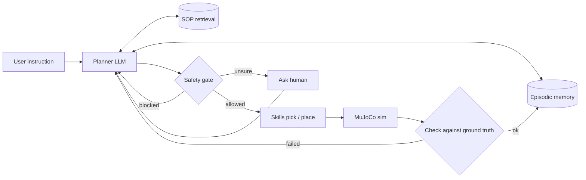

# Project

Goal, architecture, design decisions and the roadmap checklist.

## 1. Goal

Build an LLM agent that controls a simulated SO-101 robot arm in MuJoCo from natural-language instructions (including Chinese), to showcase LLM, RAG, agentic AI and LangChain/LangGraph skills.

The agent must:
- turn instructions into robot actions (tool calls)
- plan from SOP documents and cite the SOP step behind every action (RAG)
- remember what it did and where objects are (episodic memory)
- pass every action through a safety gate, and ask a human when unsure
- be scored automatically against simulator ground truth

This is a personal portfolio project, not a thesis. The robot is the stage; the agent is the star.

## 2. Scope

- **In:** simulation only (MuJoCo); scripted inverse-kinematics skills first; evaluation and a demo.
- **Out:** physical robots, ROS, training models from scratch.
- **Optional:** a pretrained SmolVLA as a skill at the very end; rent a cloud GPU only if fine-tuning is needed.

## 3. Environment

- **Hardware:** RTX 5060 Laptop GPU (8 GB VRAM), 16 GB RAM (32 GB recommended), Ubuntu.
- **Stack:** Python 3.12 (managed with uv), MuJoCo + the Menagerie SO-101 model, LangChain 1.x, LangGraph 1.x, pytest.
- **PyTorch:** RTX 50-series GPUs need a cu128 build, version 2.7 or later; not needed until Phase 3.
- **LLM:** OpenAI API (key in the local `.env` as `OPENAI_API_KEY`, never committed); the local GPU is kept for simulation and embeddings.
- **Display:** on Ubuntu with GNOME on Wayland, MuJoCo windows need `PYGLFW_LIBRARY_VARIANT=x11`.

## 4. Architecture

So far the repo has the Python setup (`pyproject.toml`, `uv.lock`, `.env.example`), the tabletop scene `sim/scene.xml`, `sim/scene_state.py` (`load_scene()`, `get_scene_state()`), `sim/arm_geometry.py` (`measure_arm_geometry()`), `sim/ik.py` (`solve_ik()`), `sim/skills.py` (`move_to()`, `open_gripper()`, `close_gripper()`, `is_holding()`, `pick()`, `held_cube()`, `place()`, `step()` with `STEP_CALLBACKS`), `sim/demo.py` (scripted demo, `--viewer`, `--video`), and tests in `tests/`. Code is added one roadmap step at a time, each with tests.

**Scene layout** (`sim/scene.xml`, units in meters): the floor plane named `table` is the tabletop; the arm stands at the origin facing +x. Cubes `red_cube`, `green_cube`, `blue_cube` (3 cm, free to move) sit at x = 0.25, y = -0.06 / 0 / 0.06. Fixed bins `left_bin` and `right_bin` (8 x 8 cm, 3 cm walls) are at (0.18, 0.18) and (0.18, -0.18). The arm reaches roughly 0.05-0.43 m at table height, so keep objects inside that range. With the gripper pointing straight down the reachable band is narrower, about x = 0.15-0.30 m and up to z = 0.07 m; higher points need a tilt (`move_to` tries 0, 15, 30, 45 and 60 degrees in that order).

## 5. Decisions (agreed 2026-10-22)

1. Simulation only: MuJoCo + Menagerie `robotstudio_so101`.
2. Low-level skills are scripted with inverse kinematics first; a VLA is optional.
3. LangChain `create_agent` as the baseline, then an explicit LangGraph state graph.
4. The LLM is called through an API and the provider can be changed by configuration. Provider: OpenAI.
5. The safety gate is pure code, never an LLM judgment; SOP text can never override its rules.
6. Success is judged from simulator ground truth, not the agent's own report; repeated runs measure consistency (pass^k).

## 6. Open decisions

- [x] Default LLM provider — OpenAI (decided 2026-10-23)
- [x] Default OpenAI model — `gpt-6-luna` (decided 2026-10-23), set as `OPENAI_MODEL` in `.env` so it can change without code edits
- [ ] Embedding model and vector store — decide in Phase 3

## 7. Roadmap

Move to the next phase only when the current phase's exit criterion is met. Ticked items are done.

**Phase 0 — Setup** (exit: `pytest` passes and the GPU is visible on the laptop)
- [x] 0.1 Install the cu128 PyTorch build on the laptop; `torch.cuda.get_device_capability()` returns (12, 0)
- [x] 0.2 MuJoCo and the SO-101 model load
- [x] 0.3 Project docs
- [x] 0.4 LLM API key and a "return hello" test

**Phase 1 — Simulation and skills** (exit: scripted pick-and-place succeeds at least 9 of 10 times)
- [x] 1.1 Scene: table, red/blue/green cubes, two bins (start from Menagerie's `scene_box.xml`)
- [x] 1.2 `get_scene_state()` returns ground-truth object positions
- [x] 1.3 Skills `move_to`, `pick`, `place` (return a failure reason string on failure), split into:
    - [x] 1.3a Arm geometry: `measure_arm_geometry()` reads link lengths and zero-pose angles from the model (`sim/arm_geometry.py`)
    - [x] 1.3b Inverse kinematics: an analytic 5-joint IK (first written in MATLAB) adapted to the SO-101, checked against MuJoCo forward kinematics (`sim/ik.py`)
    - [x] 1.3c `move_to(x, y, z)`: send IK angles to the motors and simulate until the gripper arrives
    - [x] 1.3d Gripper: `open_gripper()`, `close_gripper()`, `is_holding()`
    - [x] 1.3e `pick(cube)`: the cube leaves the table, checked with `get_scene_state()`
    - [x] 1.3f `place(bin)`: the cube ends in the bin, checked with `get_scene_state()`
- [ ] 1.4 Record video automatically; run pick-and-place 10 times, split into:
    - [x] 1.4a Step callbacks in `sim/skills.py` and a demo script `sim/demo.py` with `--viewer` to watch it live
    - [x] 1.4b `--video`: record the demo to an mp4 file in `outputs/` (git-ignored) with an offscreen renderer
    - [ ] 1.4c Run pick-and-place 10 times and report the success rate (Phase 1 exit: at least 9 of 10)

**Phase 2 — Agent skeleton** (exit: a baseline success rate)
- [ ] 2.1 Wrap skills as LangChain tools
- [ ] 2.2 ReAct baseline with `create_agent`
- [ ] 2.3 LangGraph: plan → act → check → replan
- [ ] 2.4 Test set of 10 Chinese instructions with automatic scoring

**Phase 3 — RAG and memory** (exit: SOP-task success rate above the baseline)
- [ ] 3.1 Write 5–8 SOPs; build a `search_sop` tool
- [ ] 3.2 Every step cites an SOP; with no support, retrieve again or ask a human
- [ ] 3.3 Episodic memory and a `recall` tool
- [ ] 3.4 10 SOP tasks and 10 memory questions; memory answers scored against ground truth

**Phase 4 — Safety and asking for help** (exit: attack success drops, normal tasks do not regress)
- [ ] 4.1 Rule-based safety gate
- [ ] 4.2 Ask a human via `interrupt()` when unsure
- [ ] 4.3 Attack tests: 10 poisoned SOPs and 10 jailbreak instructions

**Phase 5 — Evaluation and packaging** (exit: public repo and demo)
- [ ] 5.1 About 30–40 tasks, 5 runs each; success rate, pass^k, cost, latency
- [ ] 5.2 Ablations: remove RAG, memory, and the gate one at a time
- [ ] 5.3 Skills as an MCP server; README, results table, demo video
- [ ] 5.4 (Optional) LIBERO + SmolVLA as a learned skill

## 8. Required reading

In phase order; read each before its phase starts.

- P0 [Building effective agents](https://www.anthropic.com/research/building-effective-agents): when to use a workflow vs. an agent
- P1 [Code as Policies](https://arxiv.org/abs/2209.07753): how to design a skill API for an LLM
- P1 [SayCan](https://arxiv.org/abs/2204.01691): how planning accounts for skill feasibility
- P2 [ReAct](https://arxiv.org/abs/2210.03629): interleaving reasoning and acting
- P2 [Inner Monologue](https://arxiv.org/abs/2207.05608): replanning from environment feedback
- P3 [Self-RAG](https://arxiv.org/abs/2310.11511): when to retrieve and whether results are usable
- P3 [ALCE](https://arxiv.org/abs/2305.14627): how to evaluate citation quality
- P3 [ReMEmbR](https://arxiv.org/abs/2409.13682): spatio-temporal memory for robots
- P4 [KnowNo](https://proceedings.mlr.press/v229/ren23a.html): when to ask a human
- P4 [RoboPAIR](https://arxiv.org/abs/2410.13691): how LLM-controlled robots get jailbroken
- P5 [τ-bench](https://arxiv.org/abs/2406.12045): measuring consistency with pass^k
- P5 [Embodied Agent Interface](https://proceedings.neurips.cc/paper_files/paper/2024/hash/b631da756d1573c24c9ba9c702fde5a9-Abstract.html): attributing errors to modules
